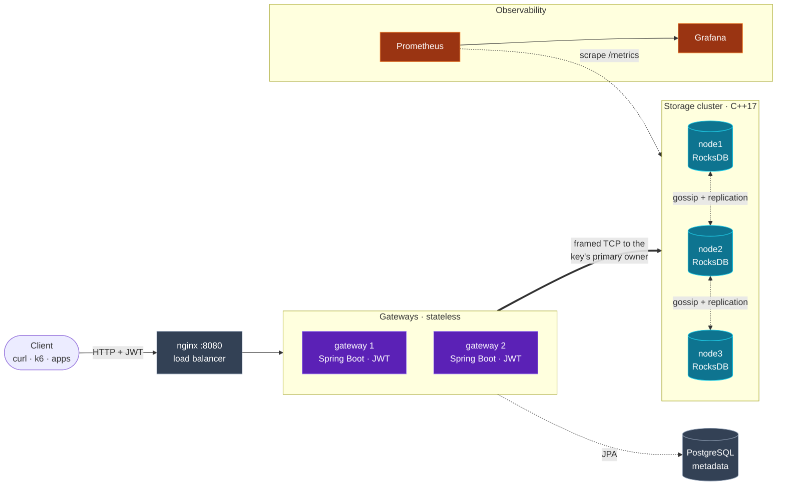
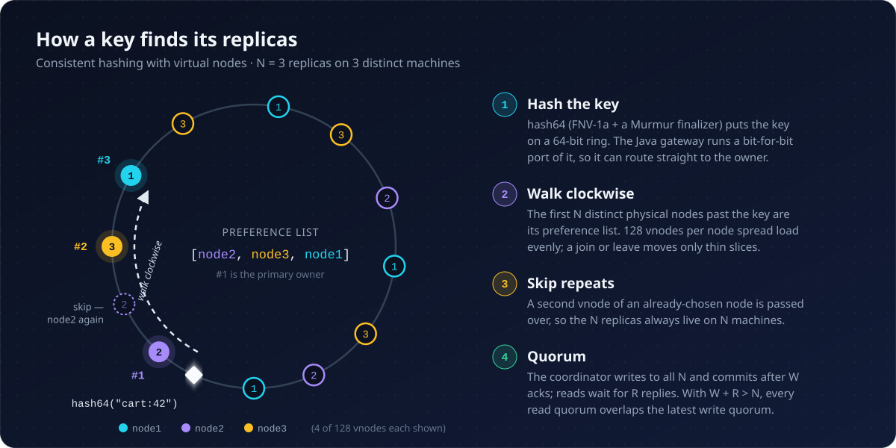
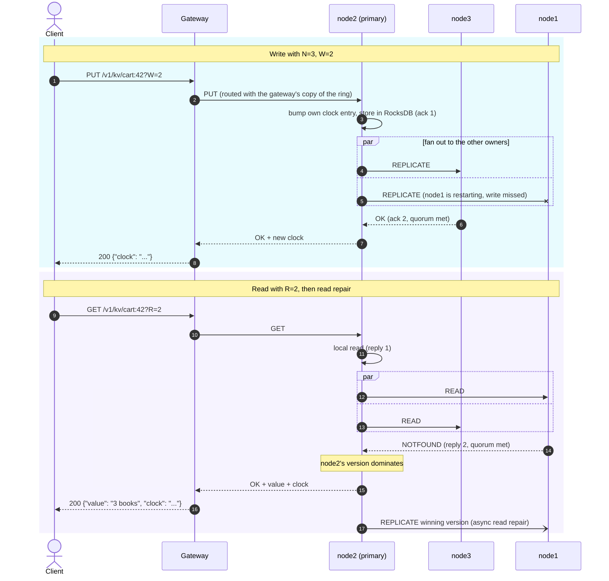
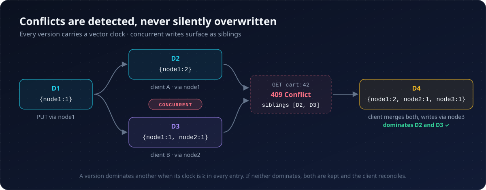
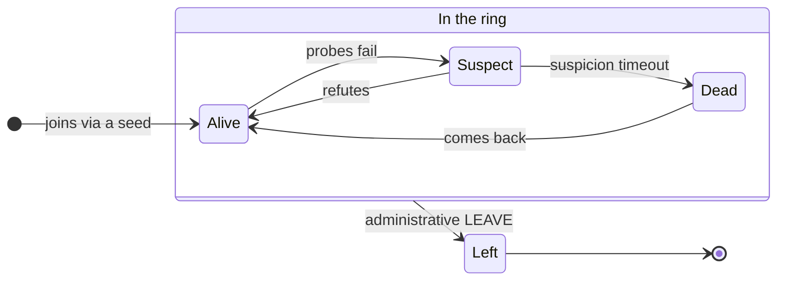
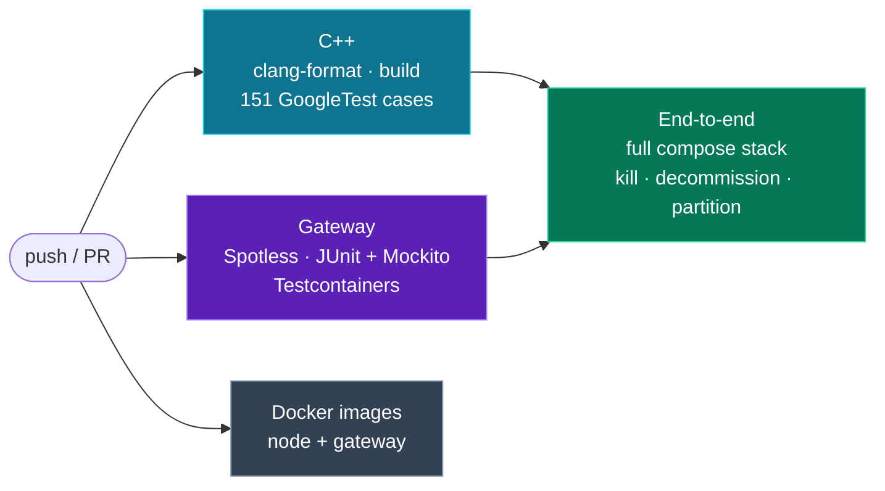

<div align="center">



<br><br>

[](https://github.com/SnehilK3372/Mini_Dynamo/actions/workflows/ci.yml)


[](LICENSE)

**A leaderless, Dynamo-style key-value store.** Consistent hashing, tunable quorums, vector clocks,<br>
read repair, hinted handoff and SWIM gossip, behind a stateless Spring Boot gateway, with failure drills in CI.

[Quick start](#quick-start) · [Architecture](#architecture) · [How it works](#how-it-works) · [Benchmarks](#benchmarks) · [Testing](#testing) · [Docs](#documentation)

</div>

---

In 2007 Amazon described [Dynamo](https://www.allthingsdistributed.com/files/amazon-dynamo-sosp2007.pdf), the store that kept shopping carts writable through crashed disks, dead servers and network splits. **Mini Dynamo rebuilds that design from first principles.** Any node can coordinate any request. Every key lives on N machines. Writes and reads succeed on a quorum, conflicting writes are *detected* instead of silently overwritten, and replicas that fall behind are healed in the background.

The happy path is the easy part. This project is about what happens when a node dies mid-write, when two clients update the same key at once, or when the network splits. Each of those cases has code, a test that exercises it, and a written design record.

## Highlights

<table>
<tr>
<td width="50%" valign="top">

#### 🧭 Consistent hashing
128 virtual nodes per server on a 64-bit ring. Every key maps to **N distinct machines**, and adding or removing a server moves only thin slices of the keyspace.

</td>
<td width="50%" valign="top">

#### ⚖️ Tunable quorum: N / W / R
Set per request. The default `3 / 2 / 2` gives `W + R > N`, so every read overlaps the latest write. Drop to `W=1` to trade durability for latency.

</td>
</tr>
<tr>
<td valign="top">

#### 🕰️ Vector clocks
Each version carries a causal history. Concurrent writes come back as **siblings** (HTTP `409`) for the client to merge. Nothing is silently lost to last-write-wins.

</td>
<td valign="top">

#### 🩹 Read repair
After it answers the client, the coordinator pushes the winning version to every replica that returned an older copy or none at all.

</td>
</tr>
<tr>
<td valign="top">

#### 📬 Hinted handoff
Sloppy quorum: a write meant for a dead owner goes to a stand-in replica plus a **hint**, which is delivered once the owner is back.

</td>
<td valign="top">

#### 📡 SWIM gossip
Peer-to-peer failure detection with indirect probes and suspicion. Membership anti-entropy heals a partition **without restarts**, and `LEAVE` decommissions a node permanently.

</td>
</tr>
<tr>
<td valign="top">

#### 💾 RocksDB per node
Shared-nothing, durable storage behind a `StorageEngine` interface. An in-memory engine keeps the unit tests fast.

</td>
<td valign="top">

#### 🔐 Stateless JWT gateway
Spring Boot 3, two replicas behind nginx. Each one hashes the key with a **bit-for-bit Java port** of the ring hash and routes straight to the key's primary owner.

</td>
</tr>
<tr>
<td valign="top">

#### 📈 Observable
Prometheus metrics from every node and gateway, a pre-provisioned Grafana dashboard, and structured JSON logs.

</td>
<td valign="top">

#### 🧪 Tested where it hurts
151 C++ and 42 Java tests, Testcontainers against the real node image, and an end-to-end run that **kills, decommissions and partitions** nodes on every PR.

</td>
</tr>
</table>

<table>
<tr>
<td align="center" valign="top" width="25%"><h3>~800 req/s</h3>through nginx → JWT gateway → quorum, on a single laptop</td>
<td align="center" valign="top" width="25%"><h3>9.7 ms</h3>GET p50 at 10 virtual users<br>(N=3, W=2, R=2)</td>
<td align="center" valign="top" width="25%"><h3>97.4 %</h3>of reads served while a node is killed mid-load</td>
<td align="center" valign="top" width="25%"><h3>151 + 42</h3>C++ / Java tests, plus e2e failure drills on every PR</td>
</tr>
</table>

<div align="center">
<sub>Numbers from <a href="bench/RESULTS.md"><code>bench/RESULTS.md</code></a>: k6 against the full Docker Compose stack on one machine. Read them as a floor, not a ceiling.</sub>

</div>

## Quick start

> **Prerequisites:** Docker with Compose v2. `curl` and `jq` for the examples.

```bash
git clone https://github.com/SnehilK3372/Mini_Dynamo.git && cd Mini_Dynamo
docker compose up --build -d        # 3 nodes · 2 gateways · nginx · Postgres · Prometheus · Grafana
```

| What | Where |
|---|---|
| REST API (nginx → 2 gateways) | <http://localhost:8080> · Swagger UI at [`/swagger-ui.html`](http://localhost:8080/swagger-ui.html) |
| Grafana dashboard | <http://localhost:3000> (`admin` / `admin`) |
| Prometheus | <http://localhost:9090> |
| Storage nodes | TCP `localhost:5001-5003` · metrics on `localhost:9101-9103/metrics` |

**Write and read a key:**

```bash
# 1. Get a JWT (dev credentials; override with AUTH_USERNAME / AUTH_PASSWORD)
TOKEN=$(curl -s -X POST localhost:8080/v1/auth/token -H 'Content-Type: application/json' \
  -d '{"username":"admin","password":"changeme"}' | jq -r .token)
AUTH="Authorization: Bearer $TOKEN"

# 2. Write: commits once 2 of the key's 3 replicas acknowledge.
#    The response is {"clock": "..."}, the version you pass back on your next write.
CLOCK=$(curl -s -X PUT 'localhost:8080/v1/kv/cart:42?W=2' -H "$AUTH" \
  -H 'Content-Type: application/json' -d '{"value":"3 books"}' | jq -r .clock)

# 3. Read: waits for 2 replicas, reconciles their versions, repairs any stale one
curl -s 'localhost:8080/v1/kv/cart:42?R=2' -H "$AUTH" | jq
```

**Then break it on purpose:**

```bash
docker stop node2 && sleep 10                                # kill a replica; gossip declares it dead
curl -s 'localhost:8080/v1/kv/cart:42?R=2' -H "$AUTH" | jq   # still served: the other two meet R=2
curl -s -X PUT 'localhost:8080/v1/kv/cart:42?W=2' -H "$AUTH" \
  -H 'Content-Type: application/json' -d "{\"value\":\"4 books\",\"clock\":\"$CLOCK\"}"
                                                             # still accepted; node2's copy is kept as a hint
for p in 9101 9103; do curl -s localhost:$p/metrics | grep hints_stored_total; done
docker start node2                                           # rejoins via gossip, the hint is delivered
```

> [!TIP]
> Sending back the `clock` you last read tells the cluster your write *supersedes* that version. A write without it is treated as one that never saw the earlier version, so the next read can return both as **siblings**. That is vector clocks working as intended (see [below](#resolving-conflicts-vector-clocks-and-siblings)).

<details>
<summary><b>More drills:</b> decommission, partition and heal, load and chaos</summary>

<br>

```bash
# Permanent removal: tell any live node that node3 is gone for good, then watch every ring shrink
docker stop node3 && bash scripts/leave.sh localhost:5001 node3
for p in 9101 9102; do curl -s localhost:$p/metrics | grep '^minidynamo_ring_physical_nodes'; done

# Partition and heal: node2 converges with no restart (digest sync + resurrection probe)
docker network disconnect minidynamo_dhtnet node2      # network is <project>_dhtnet, see `docker network ls`
docker network connect    minidynamo_dhtnet node2
curl -s localhost:9102/metrics | grep -E 'ring_physical_nodes|membership_syncs_total'

# Load and chaos (k6)
N=3 W=2 R=2 VUS=50 DURATION=30s bench/run.sh
bench/chaos.sh                                         # kill a node mid-load, measure availability + repair
```

All of these, with expected output and troubleshooting, are in [`docs/runbooks/local-dev.md`](docs/runbooks/local-dev.md). `scripts/e2e.sh` runs the same drills with assertions.

</details>

## Architecture



**The life of a request:**

1. **nginx** round-robins across **two stateless gateway replicas** (Spring Boot, JWT-authenticated).
2. The gateway hashes the key against a **locally cached ring**, refreshed every 5 s from the cluster's `RING` command, and opens a pooled socket **straight to the key's primary owner**. If its ring is stale it falls back to the next owners and then the seeds. That costs at most a hop, because the receiving node always coordinates against its own ring.
3. The node's `TCPServer` hands the connection to a fixed **thread pool**. Connections are persistent and carry many **length-prefixed frames**.
4. The **`Coordinator`** asks the **`Router`** for the key's N owners, fans out, waits for **W acks** (writes) or **R replies** (reads), reconciles vector clocks, and returns the winner or the siblings. Stale replicas are **read-repaired** asynchronously. Owners that gossip reports dead are **skipped on reads** and get a **hint plus a stand-in** on writes.

## How it works

### Placing keys: consistent hashing with virtual nodes

<p align="center">
  
</p>

### Writing and reading: quorums and read repair



### Resolving conflicts: vector clocks and siblings

<p align="center">
  
</p>

A clock is a map of `node → counter`. The coordinator of every write bumps its own entry above anything it has seen. Clocks are bounded to `MAX_CLOCK_ENTRIES` (default 20) by pruning the oldest entries, which can at worst surface a false conflict and is designed never to hide a real one.

### Membership: SWIM gossip



Dynamo separates **temporary** failures from **permanent** ones, and so does Mini Dynamo:

| | Gossip-detected **Dead** | Administrative **Left** |
|---|---|---|
| Trigger | missed probes plus a suspicion timeout | `LEAVE\|<node_id>` sent to any live node ([`scripts/leave.sh`](scripts/leave.sh)) |
| Ring | **stays in the ring**, so ownership does not reshuffle on a blip | **removed from the ring** for good |
| Reads / writes | skipped on reads; writes go to a stand-in plus a hint | its key ranges move to the next owners |
| Way back | rejoins on its own, hints are delivered | never: a replacement gets a fresh `NODE_ID` |

Every `SWIM_ACK` carries a **membership digest**. A mismatch that persists triggers a `SWIM_SYNC` push-pull exchange of full state, so a gossip event lost to a partition is only a temporary divergence.

## Benchmarks

k6 drives the full HTTP + JWT path (nginx → gateway → coordinator → replicas) over a 200-key pool with 30 % writes. All nine containers share **one Windows laptop** under Docker Desktop, so treat the absolute numbers as a floor. The comparisons and the availability result are the real signal.

| Profile | W | VUs | Throughput | GET p50 | GET p95 | PUT p50 | PUT p95 | Writes rejected |
|---|:---:|:---:|---:|---:|---:|---:|---:|---:|
| baseline | 2 | 10 | **783 req/s** | 9.7 ms | 18.4 ms | 11.9 ms | 22.2 ms | 0.00 % |
| higher load | 2 | 50 | **806 req/s** | 15.1 ms | 42.6 ms | 17.9 ms | 47.4 ms | 0.43 % |
| loose quorum | 1 | 50 | **850 req/s** | 12.8 ms | 43.8 ms | 14.8 ms | 54.6 ms | 0.10 % |

**Kill a node mid-load (`bench/chaos.sh`):** 97.4 % of reads succeed across the whole window, including the instant of the kill, and once the node restarts read repair heals its stale copies (`read_repair_total` +6). Methodology, the p99 tail under saturation and the W=1 vs W=2 trade-off are in [`bench/RESULTS.md`](bench/RESULTS.md).

> [!NOTE]
> The *scaling* benchmark (5 → 100 nodes on multi-host Docker Swarm) is built in [`bench/scale/`](bench/scale/) but **has not been run yet**. [`bench/scale/RESULTS.md`](bench/scale/RESULTS.md) is empty on purpose rather than filled with estimates.

## Testing



| Layer | What it covers | Run it |
|---|---|---|
| **Unit (C++)** | ring and hashing, vector-clock comparison and pruning (incl. property tests), quorum arithmetic, coordinator, SWIM, hints, Merkle trees, connection and thread pools, RocksDB persistence, an **in-process multi-node cluster harness** | `scripts/dev-test.sh` |
| **Unit (Java)** | gateway service layer with the cluster mocked (404 / 409 / 502 / 503 paths), JWT, the wire codec, the Java ring hash | `cd gateway && ./mvnw test` |
| **Integration** | REST Assured against real PostgreSQL via Testcontainers; `RealClusterIT` drives the **actual C++ node image** over the real wire protocol | `cd gateway && NODE_IMAGE=mini-dynamo-node:ci ./mvnw verify` |
| **End-to-end** | availability under a node kill, convergence on recovery, permanent decommission, and partition healing via membership anti-entropy | `scripts/e2e.sh` |

`scripts/dev-test.sh` runs every C++ check (format, build, tests) inside the same Debian image CI uses. The complete guide to building, running and testing is [`docs/runbooks/local-dev.md`](docs/runbooks/local-dev.md).

## Built tier by tier

Each tier was planned, built with tests, and closed with a design record covering the choices made, the alternatives rejected, and where it could break.

| Tier | What it added | Record |
|---|---|---|
| 0 | Cleanup and a pluggable storage interface | [tier-0](docs/decisions/tier-0.md) |
| 1A | **The distributed core:** RocksDB, real W/R quorum, vector clocks, read repair | [tier-1a](docs/decisions/tier-1a.md) |
| 1B | Spring Boot gateway, JWT auth, PostgreSQL metadata | [tier-1b](docs/decisions/tier-1b.md) |
| 1C | Prometheus, Grafana, structured JSON logs | [tier-1c](docs/decisions/tier-1c.md) |
| 1D | Test pyramid and GitHub Actions CI | [tier-1d](docs/decisions/tier-1d.md) |
| 2 | k6 load tests and node-kill chaos | [tier-2](docs/decisions/tier-2.md) |
| 3 | Single-box AWS EC2 deployment | [tier-3](docs/decisions/tier-3.md) |
| 4.1 | SWIM gossip membership and failure detection | [tier-4.1](docs/decisions/tier-4.1.md) |
| 4.2 | Hinted handoff and Merkle trees | [tier-4.2](docs/decisions/tier-4.2.md) |
| 4.3 | Connection pooling, thread pool, liveness-aware reads | [tier-4.3](docs/decisions/tier-4.3.md) |
| 4.4 | Horizontal gateways and ring-aware routing | [tier-4.4](docs/decisions/tier-4.4.md) |
| 4.5 | Bounded vector clocks and multi-host Docker Swarm | [tier-4.5](docs/decisions/tier-4.5.md) |
| test | In-process cluster harness and vector-clock properties (it found 3 live bugs) | [tier-testing](docs/decisions/tier-testing.md) |
| 4.6 | Permanent node removal (`LEAVE`) | [tier-4.6](docs/decisions/tier-4.6.md) |
| 4.7 | Membership anti-entropy and audit hardening | [tier-4.7](docs/decisions/tier-4.7.md) |

## Reference

<details>
<summary><b>Node configuration</b> (environment variables)</summary>

<br>

A node is configured entirely by environment variables:

| Variable | Meaning |
|---|---|
| `NODE_ID` | Unique node name (also its hostname on the ring). 1-64 chars from `[A-Za-z0-9._-]`; an invalid id refuses to boot |
| `NODE_PORT` | TCP port to listen on |
| `HOST` | Bind address (default `0.0.0.0`) |
| `SEED_NODES` | Comma-separated `host:port` seeds to gossip-join through; **omit to self-bootstrap the ring**. (`BOOTSTRAP_IP`/`BOOTSTRAP_PORT` still work as a single seed) |
| `ADVERTISE_HOST` | Hostname peers use to reach this node (default `NODE_ID`) |
| `VNODES` | Virtual nodes per physical node (default 128). Must match the gateway's `cluster.virtual-nodes` |
| `STORAGE_ENGINE` | `rocksdb` (default when compiled with RocksDB) or `memory` |
| `DATA_DIR` | RocksDB directory (default `/data/<NODE_ID>`) |
| `MAX_CLOCK_ENTRIES` | Vector-clock bound (default 20) |
| `WORKER_THREADS` / `POOL_MAX_CONNS_PER_PEER` | Server thread pool / per-peer connection pool |
| `GOSSIP_*` | SWIM period, ping timeout, K, suspicion multiplier |

Building outside Docker requires Linux (POSIX sockets): `cmake -S . -B build && cmake --build build -j4` produces `build/kvstore`. The unit tests build anywhere.

</details>

<details>
<summary><b>Wire protocol</b> (node-to-node and gateway-to-node)</summary>

<br>

Plain TCP, **length-prefixed frames** (`<byte-length>\n<payload>`) with a pipe-delimited payload. Connections are **persistent**: one socket carries many request/response pairs. Values are **base64-encoded**, so arbitrary bytes (including `|` and newlines) are safe. Vector clocks serialize as `node1:3:1720000000000` (`node:counter:timestamp`); the timestamp only drives pruning and never affects causality.

| Request | Response |
|---|---|
| `PUT\|<key>\|<b64value>\|<origin>\|<N>\|<W>\|<R>\|<clock>` | `RESPONSE\|OK\|<clock>` or `RESPONSE\|ERROR\|<reason>` |
| `GET\|<key>\|<origin>\|<N>\|<R>` | `RESPONSE\|OK\|<b64value>\|<clock>`, `RESPONSE\|SIBLINGS\|<n>\|<b64v>\|<clk>...`, `RESPONSE\|NOTFOUND`, or `RESPONSE\|ERROR\|<reason>` |
| `DELETE\|<key>\|<origin>\|<N>\|<W>\|<clock>` | `RESPONSE\|OK\|<clock>`: a versioned **tombstone**, not a local erase |
| `REPLICATE\|<key>\|<b64value>\|<origin>\|<clock>` | `RESPONSE\|OK` (internal, coordinator → replica) |
| `READ\|<key>\|<origin>` | `VAL\|<b64value>\|<clock>` or `VAL\|NOTFOUND` (internal) |
| `RING\|<origin>` | `RING\n<count>\n<id>\|<host>\|<port>\n...`: a read-only ring snapshot (the gateway polls this to route) |
| `LEAVE\|<node_id>` | `RESPONSE\|OK\|left` or `RESPONSE\|ERROR\|<reason>`: **permanently** remove a node from the ring (Tier 4.6, see `scripts/leave.sh`). Send to any live node; the target need not participate |
| `SWIM_PING` / `SWIM_PING_REQ` / `SWIM_ACK` / `SWIM_JOIN` | Gossip membership and failure detection (internal, Tier 4.1). Since Tier 4.7 every `SWIM_ACK` also carries a **membership digest** as its final field |
| `SWIM_SYNC\|<sender>\|<events>` / `SWIM_SYNC_ACK\|<sender>\|<events>` | Membership anti-entropy (internal, Tier 4.7): a push-pull full-state exchange, triggered by a persistent digest mismatch |

Node ids are validated everywhere they enter the system (Tier 4.7), because an id containing a delimiter would corrupt gossip parsing cluster-wide. *(The legacy `JOIN` verb was removed in Tier 4.7: it changed the ring with no membership checks and nothing sent it any more.)*

</details>

<details>
<summary><b>REST API</b> (gateway)</summary>

<br>

| Method | Path | Notes |
|---|---|---|
| `POST` | `/v1/auth/token` | Issue a JWT (public) |
| `PUT` | `/v1/kv/{key}` | Body `{value, clock?}`; query `N`, `W`, `R` |
| `GET` | `/v1/kv/{key}` | Query `N`, `R`. `404` if absent, `409` with siblings |
| `DELETE` | `/v1/kv/{key}` | Tombstone delete; query `clock?`, `N`, `W` |
| `GET` | `/v1/cluster/nodes` | Node registry (PostgreSQL) |
| `GET` | `/v1/cluster/ring` | Live ring (cluster `RING` command) |

Quorum not met → `503` (retryable). Concurrent siblings → `409`. Cluster unreachable → `503`. More in [`gateway/README.md`](gateway/README.md).

</details>

## Deployment (AWS)

The whole stack runs on a single EC2 instance from the same `docker compose` file, with **only nginx (`:8080`) exposed**. The gateways, Grafana, Prometheus, Postgres and the nodes stay private, and Grafana is reached over an SSH tunnel.

```bash
# On a fresh Amazon Linux 2023 / Ubuntu m7i-flex.large (>= 30 GB disk):
curl -fsSL https://raw.githubusercontent.com/SnehilK3372/Mini_Dynamo/main/deploy/aws/bootstrap.sh | bash
# then set real secrets in ~/Mini_Dynamo/.env and run: docker compose up -d
```

- **Runbook:** [`docs/runbooks/ec2-deploy.md`](docs/runbooks/ec2-deploy.md) (JWT flow, Swagger, live drills). Sizing, security groups and redeploys: [`deploy/aws/README.md`](deploy/aws/README.md). Multi-host Swarm: [`deploy/swarm/`](deploy/swarm/).
- **Redeploys are manual:** *Actions → "Deploy to EC2 (manual)"*. Nothing deploys automatically on merge.
- nginx serves plain HTTP, so the JWT travels unencrypted. That is fine for a demo; terminate TLS at nginx if you keep it up. `m7i-flex.large` is **not** free-tier, so stop the instance when idle.

> [!IMPORTANT]
> **Upgrading a box from before Tier 4.4 needs a fresh cluster.** 4.4 changed the ring hash and 4.5 the vector-clock wire format, so old data becomes unreachable and every node must run the same build. Run `docker compose down -v` before bringing the new version up.

## Honest status

- **"Scales to thousands" is unproven.** The 5 → 100 node harness exists; the multi-host run has not happened yet.
- **Merkle anti-entropy is not wired across nodes.** The tree is implemented and unit-tested, but the cross-node exchange is stubbed, so `antientropy_syncs_total` stays at 0. Read repair and hinted handoff are the convergence mechanisms that actually run.
- Every known limit (single points of failure, and what would break first at scale) is catalogued in **[`docs/scalability-constraints.md`](docs/scalability-constraints.md)**.

**Next up:** wire the `MERKLE_*` exchange so rarely-read keys converge (the largest correctness gap); per-replica sibling storage; pool the forward-to-primary and gossip paths; multiple seeds; TLS at the edge; an epoll server if a node ever needs true C10K.

## Documentation

| Document | What's in it |
|---|---|
| [`docs/full_arch.md`](docs/full_arch.md) | The target end-state design and the reasoning behind every tool choice |
| [`docs/focused_arch.md`](docs/focused_arch.md) · [`docs/build_plan.md`](docs/build_plan.md) | The scoped plan that was actually built, tier by tier |
| [`docs/roadmap.md`](docs/roadmap.md) | Tier 4 status and candidate follow-ups |
| [`docs/decisions/`](docs/decisions/) | One design record per tier: choices, rejected alternatives, failure modes |
| [`docs/scalability-constraints.md`](docs/scalability-constraints.md) | What limits the system today, from a code-level audit |
| [`docs/runbooks/`](docs/runbooks/) | Local development and EC2 operations |
| [`bench/RESULTS.md`](bench/RESULTS.md) | Load and chaos results with methodology |

<details>
<summary><b>Repository layout</b></summary>

<br>

```text
Mini_Dynamo/
├── src/                    C++17 node
│   ├── coordinator.*       quorum fan-out, clock reconciliation, read repair, sloppy quorum
│   ├── router.*            consistent-hash ring (virtual nodes, 64-bit hash)
│   ├── vector_clock.*      causality, comparison, pruning
│   ├── gossip/             SWIM membership, failure detection, anti-entropy sync
│   ├── hints/              hinted-handoff store and delivery thread
│   ├── antientropy/        Merkle tree (cross-node exchange still stubbed)
│   ├── net/                framing, TCP server, thread pool, connection pool
│   └── storage/            StorageEngine interface: RocksDB and in-memory
├── gateway/                Spring Boot 3 REST gateway (JWT, JPA, ring-aware routing)
├── tests/                  GoogleTest suite, incl. an in-process cluster harness
├── bench/                  k6 load test, chaos script, scaling harness
├── deploy/                 nginx, Prometheus, Grafana, AWS bootstrap, Docker Swarm
├── scripts/                dev-test.sh · e2e.sh · leave.sh
└── docs/                   architecture, decisions, runbooks, constraints
```

</details>

---

<div align="center">
<sub>MIT licensed · Inspired by <a href="https://www.allthingsdistributed.com/files/amazon-dynamo-sosp2007.pdf">DeCandia et al., <i>Dynamo: Amazon's Highly Available Key-value Store</i>, SOSP 2007</a></sub>
</div>
